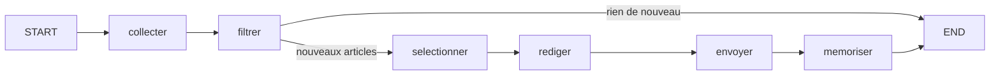

# Agent de veille IA (LangGraph + Gemini)

Agent IA qui fait ma veille technologique à ma place : il collecte les nouveautés dans mes domaines, sélectionne les plus utiles selon mon niveau, rédige un mail en français avec résumés et exercices pratiques, puis me l'envoie automatiquement deux fois par semaine.

## Domaines suivis

- Data engineering / BI
- Agents IA / LLM
- Vision par ordinateur
- Robotique / voiture autonome

## Fonctionnement



1. **collecter** : récupère les articles des 4 derniers jours (flux RSS, API arXiv).
2. **filtrer** : retire les articles déjà envoyés lors des veilles précédentes.
3. **selectionner** : Gemini garde les 2 articles les plus utiles par domaine, selon mon niveau.
4. **rediger** : Gemini rédige le mail en français (titres traduits, résumés, un exercice pratique par domaine).
5. **envoyer** : mise en page HTML et envoi via Gmail (SMTP).
6. **memoriser** : enregistre les articles envoyés dans l'historique.

## Points techniques

- **LangGraph** : graphe à état partagé, arête conditionnelle (arrêt si aucun nouvel article).
- **Mémoire** : historique des articles envoyés (`historique.json`), mis à jour automatiquement par le workflow pour éviter les doublons.
- **Résilience** : bascule automatique entre 3 modèles Gemini (`with_fallbacks`) et relance des nœuds avec `RetryPolicy` en cas d'indisponibilité de l'API.
- **Automatisation** : GitHub Actions, exécution le lundi et le jeudi matin, avec commit automatique de la mémoire.
- **Sécurité** : clés API et identifiants stockés dans les secrets GitHub, jamais dans le code.

## Stack

Python, LangGraph, LangChain, Gemini API, feedparser, GitHub Actions

## Lancer le projet en local

```
git clone https://github.com/MatthAkl/agent-veille.git
cd agent-veille
python -m venv venv
venv\Scripts\activate
pip install -r requirements.txt
```

Créer un fichier `.env` à la racine :

```
GOOGLE_API_KEY=...
GEMINI_MODEL=...
GEMINI_MODEL_SECOURS=...
GEMINI_MODEL_SECOURS_2=...
GMAIL_ADRESSE=...
GMAIL_MOT_DE_PASSE_APP=...
MAIL_DESTINATAIRE=...
```

Puis lancer l'agent :

```
python agent.py
```

## Évolutions prévues

- Suivi des exercices réalisés pour adapter automatiquement le niveau
