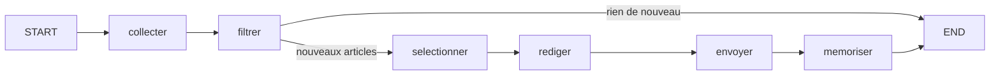

# Agent de veille IA (LangGraph + Gemini)

Agent IA qui fait ma veille technologique à ma place : il collecte les nouveautés dans mes domaines, sélectionne les plus utiles selon mon niveau, rédige un mail en français avec résumés et exercices pratiques, puis me l'envoie automatiquement deux fois par semaine.

## Domaines suivis

- Data engineering / BI
- Agents IA / LLM
- Vision par ordinateur
- Robotique / voiture autonome

## Fonctionnement

1. **collecter** : récupère les articles des 4 derniers jours (flux RSS, API arXiv).
2. **filtrer** : retire les articles déjà envoyés lors des veilles précédentes.
3. **selectionner** : Gemini garde les 2 articles les plus utiles par domaine, selon mon niveau.
4. **rediger** : Gemini rédige le mail en français (titres traduits, résumés, un exercice pratique par domaine).
5. **envoyer** : mise en page HTML et envoi via Gmail